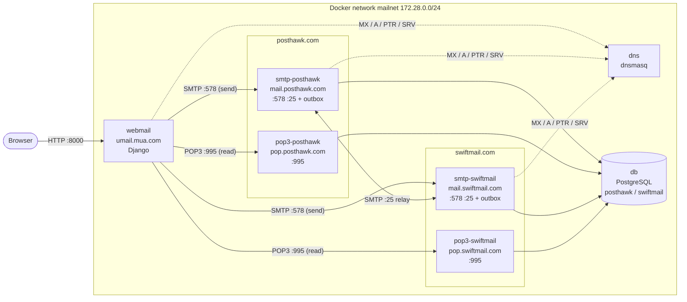

# umail: SMTP and POP3 mail servers from scratch

A small mail system written on raw sockets: an SMTP server (user submission and
server-to-server relay), a POP3 server, an outbox delivery worker and a Django
webmail client. Two fake mail domains, `posthawk.com` and `swiftmail.com`, run
side by side and exchange mail with each other. Their own DNS server provides
the MX, A, PTR and SRV records.

Every part runs in its own Alpine container on one private Docker network.

> Originally a semester-3 computer networks project (early 2025). This
> version is a rewrite of that code. It keeps the same protocol behaviour and
> uses a cleaner object-oriented design, documentation, tests and a
> reproducible Docker setup.

## Architecture



| Container | Image | IP | Role |
|---|---|---|---|
| `dns` | alpine + dnsmasq | 172.28.0.2 | Serves A, PTR, MX and SRV records for both domains |
| `db` | postgres:17-alpine | 172.28.0.3 | One database per domain (`posthawk`, `swiftmail`) |
| `smtp-posthawk` / `smtp-swiftmail` | python:3.12-alpine | .10 / .20 | SMTP submission on port 578, SMTP relay on port 25, outbox worker |
| `pop3-posthawk` / `pop3-swiftmail` | python:3.12-alpine | .11 / .21 | POP3 on port 995 |
| `webmail` | python:3.12-alpine | .30 | Django mail client, published on `localhost:8000` |

The mail server image is shared by all four mail containers. The command
(`smtp` or `pop3`) and environment variables (`MAIL_DOMAIN`, `MAIL_HOSTNAME`,
...) decide which domain and which service a container runs.

## Quick start

Requirements: Docker with Compose v2.

```bash
cp .env.example .env
```

Put a real secret in `DJANGO_SECRET_KEY` inside `.env`:

```bash
python3 -c "import secrets; print(secrets.token_urlsafe(50))"
```

Then start the stack:

```bash
docker compose up -d --build
```

Open <http://localhost:8000> and sign in with one of the demo mailboxes:

| Mailbox | Password |
|---|---|
| `alice@posthawk.com` | `alice123` |
| `bob@posthawk.com` | `bob123` |
| `charlie@swiftmail.com` | `charlie123` |

Send mail from alice to bob (local delivery) or to charlie (relayed between
the two domains by the outbox worker within about 10 s), then log in as the
recipient.

To start again from an empty database:

```bash
docker compose down -v
```

## Talking to the servers by hand

The servers speak plain SMTP and POP3, so any client works. You can start a
throwaway shell on the network:

```bash
docker run --rm -it --network umail_mailnet --dns 172.28.0.2 alpine sh -c "apk add -q busybox-extras && sh"
```

```text
/ # telnet pop.posthawk.com 995
+OK POP3 server ready
USER bob@posthawk.com
+OK User bob@posthawk.com exists
PASS bob123
+OK User auth success
LIST
+OK 1 messages (132 octets)
1 132
.
```

```text
/ # telnet mail.posthawk.com 578
220 mail.posthawk.com ESMTP umail
HELO laptop
250-mail.posthawk.com Hello laptop
250 AUTH PLAIN
AUTH PLAIN AGFsaWNlQHBvc3RoYXdrLmNvbQBhbGljZTEyMw==
235 Authentication successful
MAIL FROM:<alice@posthawk.com>
250 OK
RCPT TO:<charlie@swiftmail.com>
250 User charlie@swiftmail.com exists
DATA
354 End data with <CR><LF>.<CR><LF>
Subject: hi
From: alice@posthawk.com
To: charlie@swiftmail.com
Date: 2025-02-20 10:00:00

Hello Charlie!
.
250 OK: Queued for delivery, ID: 3
```

See [docs/PROTOCOLS.md](docs/PROTOCOLS.md) for every command and reply.

## Tests

The unit tests cover the message format:

```bash
cd mailserver && pip install -r requirements.txt pytest && python -m pytest -q
```

The end-to-end test runs against the live stack with Python's standard
`smtplib` and `poplib`. It checks AUTH, local delivery, relay through the
outbox, VRFY, POP3 LIST/RETR/TOP/DELE/RSET/QUIT and the main rejections:

```bash
docker run --rm --network umail_mailnet --dns 172.28.0.2 -v ./scripts:/scripts:ro --entrypoint python umail/mailserver /scripts/smoke_test.py
```

GitHub Actions runs both on every push ([.github/workflows/ci.yml](.github/workflows/ci.yml)).

## Project layout

```
├── docker-compose.yml        all 7 containers, fixed IPs on network "mailnet"
├── infra/
│   ├── dns/                  Alpine + dnsmasq image and its records
│   └── db/                   schema.sql and the first-start init script (DBs + demo users)
├── mailserver/               SMTP / POP3 / outbox server (asyncio, one image)
│   └── mailserver/
│       ├── __main__.py       CLI: python -m mailserver smtp|pop3
│       ├── server.py         MailServer: binds sessions to ports, starts the outbox
│       ├── config.py         Settings from environment variables
│       ├── database.py       Database: asyncpg pool, every SQL query lives here
│       ├── resolver.py       DnsResolver: A / PTR / MX lookups, forward-confirmed reverse DNS
│       ├── message.py        Message: the mail format shared by SMTP, POP3 and webmail
│       ├── session.py        LineSession: base class (line I/O, idle timeout, close)
│       ├── smtp/
│       │   ├── session.py    SubmissionSession (578) and RelaySession (25)
│       │   ├── client.py     SmtpClient: outbound VRFY probe and delivery
│       │   └── outbox.py     OutboxWorker: retries remote delivery
│       └── pop3/
│           ├── session.py    Pop3Session (995)
│           └── mailbox.py    Mailbox: per-session maildrop view, DELE/RSET/commit
├── webmail/                  Django MUA ("umail")
│   └── main/
│       ├── mailclient.py     UserConnection (smtplib + poplib), MailServers (MX/SRV discovery)
│       ├── connection_manager.py  per-user connection registry
│       └── views.py          login, dashboard, send, delete
├── scripts/smoke_test.py     end-to-end test
└── docs/                     architecture, protocol reference, original presentation
```

## Documentation

- [docs/ARCHITECTURE.md](docs/ARCHITECTURE.md): how mail flows, the DNS-based trust model, the database schema and design decisions
- [docs/PROTOCOLS.md](docs/PROTOCOLS.md): SMTP and POP3 command reference for these servers
- [docs/CHANGES.md](docs/CHANGES.md): what changed from the original 2025 code and why

## Limits

This is a learning project, not a production mail server:

- No TLS. Port 995 carries plain-text POP3, as in the original project.
- The message format is a fixed Subject/From/To/Date layout with exactly one
  recipient. It is not full RFC 5322 / MIME.
- There is no EHLO, so it has no ESMTP extensions.
- The webmail keeps open sockets in memory, so it runs as a single process.

## Author

Arya Soni
