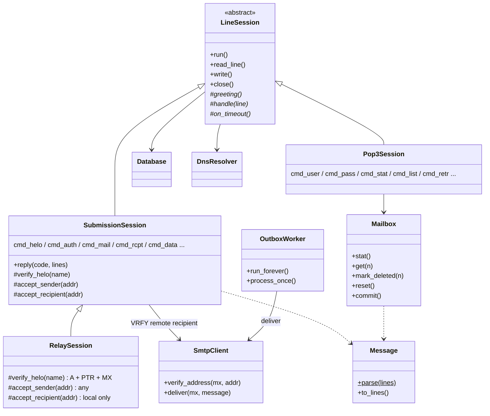
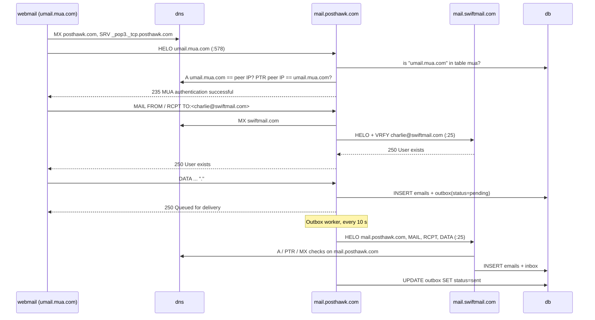

# Architecture

## Components

| Piece | Code | Runs in |
|---|---|---|
| SMTP submission (port 578) | `mailserver/smtp/session.py` `SubmissionSession` | `smtp-<domain>` |
| SMTP relay (port 25) | `mailserver/smtp/session.py` `RelaySession` | `smtp-<domain>` |
| Outbox worker | `mailserver/smtp/outbox.py` `OutboxWorker` | `smtp-<domain>` |
| POP3 (port 995) | `mailserver/pop3/session.py` `Pop3Session` | `pop3-<domain>` |
| Webmail (MUA) | `webmail/main/` | `webmail` |
| DNS | `infra/dns/dnsmasq.conf` | `dns` |
| Storage | `infra/db/schema.sql` | `db` |

The outbox worker runs in the SMTP container on purpose. When it connects to
a remote server, the remote server checks that the connecting IP belongs to
`mail.<domain>`. So outgoing mail has to leave from the container that owns
that name.

## Class overview



`RelaySession` is the same SMTP state machine as `SubmissionSession`. It only
overrides three hooks: who is trusted, which senders are accepted and which
recipients are accepted. The original project had the same `client` →
`server` inheritance.

## Mail flow

### Sending from the webmail to another domain



### Local delivery

When the recipient is on the same domain, `DATA` writes the `inbox` row
straight away and records the `outbox` row as `sent`. The worker never touches
it.

### Reading

The webmail logs in to POP3 with `USER` and `PASS`. That is how the user's
password gets checked. Each time the dashboard loads, the webmail sends `QUIT`
(which commits any `DELE`), reconnects and logs in again. This way new mail
shows up without logging out of the webmail.

## Trust model (DNS based)

There is no TLS and there are no client certificates. Trust comes from DNS, as
in the original project:

| Peer | Port | Accepted when |
|---|---|---|
| End user | 578 | `AUTH PLAIN` with a bcrypt-checked password; may only send as itself |
| Trusted MUA (webmail) | 578 | HELO name is listed in the `mua` table **and** `A(name) == peer IP` **and** `PTR(peer IP) == name` (reply `235`); may send as any local user |
| Remote mail server | 25 | `A(name) == peer IP`, `PTR(peer IP) == name` **and** `name` is the MX of its own domain; may only deliver to local users |

The servers always query the project DNS server directly (`DNS_SERVER`), never
Docker's built-in resolver. Docker's resolver would answer PTR queries for
container IPs with container names.

### DNS records (`infra/dns/dnsmasq.conf`)

| Record | Value |
|---|---|
| A + PTR | `mail.posthawk.com` 172.28.0.10, `pop.posthawk.com` .11, `mail.swiftmail.com` .20, `pop.swiftmail.com` .21, `umail.mua.com` .30 |
| MX | `posthawk.com` → `mail.posthawk.com`, `swiftmail.com` → `mail.swiftmail.com` |
| SRV | `_pop3._tcp.<domain>` → `pop.<domain>:995` (RFC 6186 service discovery) |

`host-record=` creates both the A and the PTR record. The original config used
`address=`, which creates no PTR record, so the MTA check could never pass.

## Database

There is one PostgreSQL database per domain, created on first start by
`infra/db/init.sh`. The schema is in `infra/db/schema.sql`:

```
users (id, email UNIQUE, password_hash bcrypt)
mua   (id, name UNIQUE)                         trusted webmail host names
emails(id, subject, body, sender_id -> users NULL for relayed mail, sender, recipient, timestamp)
inbox (id, email_id -> emails, recipient_id -> users, is_deleted)    POP3 reads this
outbox(id, email_id -> emails, status pending|failed|sent, retry_count, last_attempt)
```

The POP3 message number is `inbox.id`. It stays the same across sessions,
which lets the webmail delete by id.

All SQL is in `mailserver/database.py`, and every value is a bound parameter.

## Configuration

Mail server environment variables (`mailserver/config.py`):

| Variable | Default | Meaning |
|---|---|---|
| `MAIL_DOMAIN` | required | Local domain, e.g. `posthawk.com` |
| `MAIL_HOSTNAME` | `mail.<domain>` | Name used in greetings and outgoing HELO |
| `DNS_SERVER` | required | IP of the dnsmasq container |
| `DATABASE_URL` | required | PostgreSQL DSN |
| `SMTP_SUBMISSION_PORT` / `SMTP_RELAY_PORT` / `POP3_PORT` | 578 / 25 / 995 | Listen ports |
| `IDLE_TIMEOUT` | 180 | Seconds before an idle session is closed |
| `OUTBOX_INTERVAL` / `OUTBOX_MAX_RETRIES` | 10 / 3 | Outbox polling interval and attempts |

Webmail environment variables (`webmail/umail/settings.py`):
`DJANGO_SECRET_KEY`, `DJANGO_DEBUG`, `DJANGO_ALLOWED_HOSTS`,
`MAIL_DNS_SERVER`, `MUA_HOSTNAME`, `SMTP_SUBMISSION_PORT`.

## Design decisions

- **asyncio, one coroutine per connection.** This is the same model as the
  original. The blocking SQLite calls became `asyncpg`, so one slow query no
  longer stalls every session.
- **PostgreSQL in its own container** instead of a SQLite file inside each mail
  container. This lets SMTP and POP3 run as separate containers that share one
  mailbox store.
- **The webmail has no database.** Sessions are signed cookies and mail stays
  on the servers. The SMTP/POP3 sockets live in a process-wide registry, as in
  the original, so gunicorn runs a single worker with threads.
- **The webmail uses the standard `smtplib`/`poplib`.** Because the servers
  follow the RFC framing (multi-line replies, dot-stuffing), stock clients
  work against them. This also acts as a compliance check.
- **Containers run as non-root.** The `net.ipv4.ip_unprivileged_port_start=0`
  sysctl lets the SMTP container bind port 25 without root.
